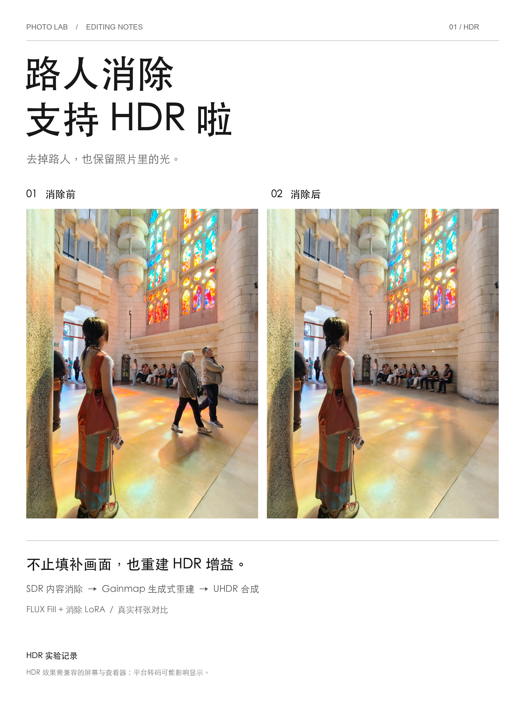
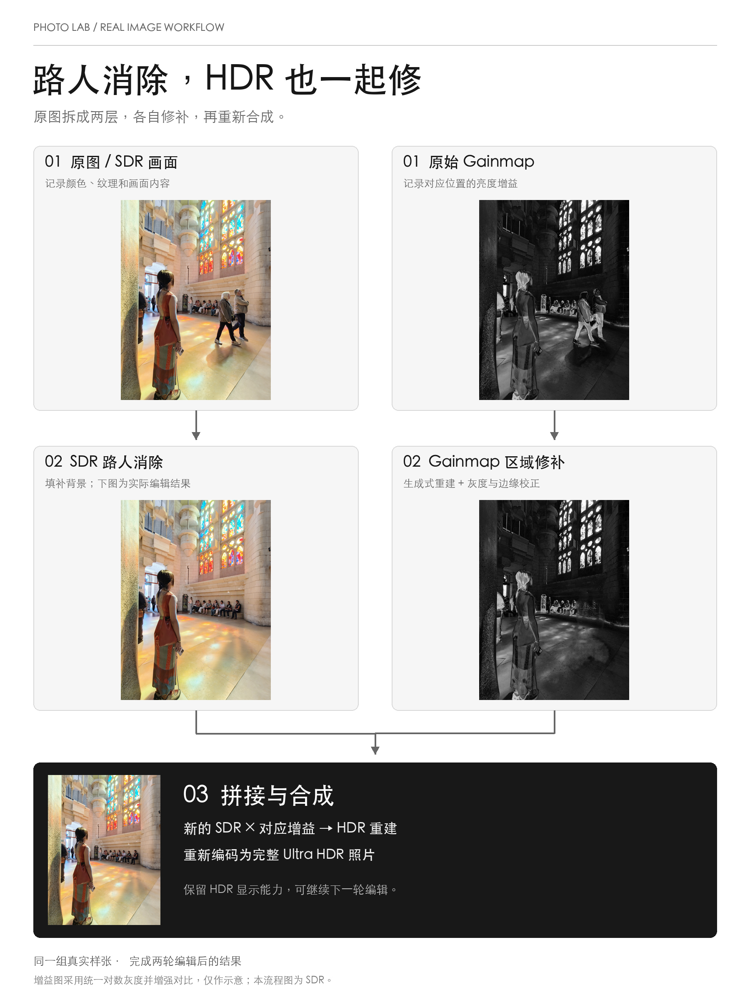

# HDR Inpainting · 支持 HDR 的 AI 对象消除

[中文](#中文) · [English](#english)

### 效果与原理 / Demo & workflow

用于小红书分享的真实样张介绍图与流程图。下方内嵌图片为 SDR 预览；
流程图中的 gainmap 使用统一对数灰度并增强对比度，仅用于说明。

Real-image cover and workflow illustrations prepared for Xiaohongshu.
The embedded images are SDR previews; gainmaps in the diagram use a shared
logarithmic grayscale with enhanced contrast for illustration.

<p align="center">
  
</p>

[下载 Display P3 HDR 介绍图 / Download the Display P3 HDR cover](docs/images/hdr-inpainting-cover-p3-hdr.jpg)
（下载原文件，用兼容 HDR 的查看器打开 / Download the original file and open it in an HDR-compatible viewer.）

<p align="center">
  
</p>

## 中文

**消除照片里的路人，同时保留 HDR 的高光表现。**

这是一个浏览器交互式 Ultra HDR 编辑实验。核心思路很简单：
**SDR 内容消除 + Gainmap 修补 + HDR 重建与合成**。

Ultra HDR JPEG 可以理解为一张 SDR 照片，加上一张描述亮度增益的 gainmap。
如果只消除 SDR 里的对象，增益图里仍可能保留旧对象的信息，导致 HDR 显示时
出现残影或不自然的亮度。这个项目同时处理两层，再输出可继续编辑的 HDR 照片。

### 工作流程

```text
Ultra HDR → 解码 SDR / HDR → 套索圈选 + SAM 分割 → 编辑蒙版
                              │
             ┌────────────────┴────────────────┐
             ↓                                 ↓
   SDR：FLUX Fill + 消除 LoRA          单通道 gainmap：生成式修补
             │                         或 Poisson 平滑插值
             └────────────────┬────────────────┘
                              ↓
                重建编辑区域 HDR，合成完整画面
                              ↓
         Display P3 JPEG HDR · ISO 21496-1 + XMP + EXIF
                              ↓
                   继续圈选编辑 / 保存本地作品集
```

工作 gainmap 从解码后的 SDR/HDR 推导；生成模式处理标量 log-gain，再做边界校正。
当前不使用 ControlNet，也不以生成后的 RGB 引导 gainmap。Fill 模型实际接收图像
和蒙版，最终局部拼接负责限制画面修改范围。

### 功能与默认配置

- 套索圈选、本地 SAM 2.1 分割、蒙版整理与本地保存。
- 网页内容引擎：FLUX.1 Fill-dev + ObjectRemovalFluxFill v2（默认）和 OpenCV。
- Gainmap：生成式修补（默认）或平滑插值；最终输出单通道 gainmap。
- 测试样张图集，SDR、gainmap、HDR 消除前后对比。
- 消除结果自动成为下一轮底图；完整 UHDR 文件可保存到本地作品集。
- Display P3 HDR 输出、ISO/XMP 双元数据、原图 EXIF 保留。

当前验证环境是 Mac 运行网页、Python 后端、SAM 和 HDR 编解码，Windows GPU
运行 ComfyUI。两端可经 Tailscale 或局域网连接。SAM 自动选择 CUDA、Apple MPS
或 CPU；生成模型在 ComfyUI 所在机器执行。

当前 Fill 工作流所用文件名如下，定义见 `seg_ui/backend/run_mask_probe.py`：

| 用途 | 模型文件 |
| --- | --- |
| Fill 主模型 | `flux1-fill-dev-Q4_K_S.gguf` |
| 文本编码器 | `t5xxl_fp8_e4m3fn.safetensors`、`clip_l.safetensors` |
| VAE | `flux-vae-bf16.safetensors` |
| 消除 LoRA | `removal_timestep_alpha-2-1740.safetensors` |

ComfyUI 需安装工作流所用节点，包括支持 `UnetLoaderGGUF` 的节点。模型权重不随仓库分发。
SDR 默认 20 步，可选 12 步；生成式 gainmap 使用 8 步、工作区域最长边 576。
此前完整流程约需两分钟，实际受选区、显卡、网络和模型缓存影响。网页百分比为估算，
详细阶段耗时记录在任务目录的 `timings.json` 中。

### 快速开始（Mac + 已配置的 ComfyUI）

需要 Git、CMake、C/C++ 编译工具、Python，以及 Node.js ≥ 22.13。
本机 Python 3.13 环境已验证；依赖见 `seg_ui/backend/requirements.txt`。

```bash
git clone --recurse-submodules https://github.com/traviszhao96-cmd/HDR_Inpainting.git
cd HDR_Inpainting

# 新克隆时应用一次本项目的 libultrahdr 修复补丁
git -C libultrahdr apply ../scripts/libultrahdr-local-fixes.patch
cmake -S libultrahdr -B build -DUHDR_WRITE_ISO=ON -DUHDR_WRITE_XMP=ON
cmake --build build -j 6

# 填写自己的 ComfyUI 地址；以下示例假设服务在本机
export COMFYUI_URL="http://127.0.0.1:8188"
cd seg_ui
./run-local.sh
```

打开 <http://localhost:3000>，后端位于 <http://127.0.0.1:7860>。启动脚本会安装依赖，
首次分割需要下载 SAM 权重。远程 GPU 场景请设置自己的 `COMFYUI_URL`，覆盖脚本中
开发者的机器配置。无 GPU 时可选 OpenCV＋平滑 gainmap 验证通路。
重复构建无需重复应用补丁。部署详见 [DESKTOP_SETUP.md](DESKTOP_SETUP.md)，
补丁说明见 [scripts/README.md](scripts/README.md)。

### 文件与验证

| 路径 | 内容 |
| --- | --- |
| `seg_ui/test_images/` | 自己的测试照片，供底部图集切换 |
| `seg_ui/test_masks/` | 保存的测试蒙版与样例信息 |
| `seg_ui/results/<job_id>/` | 每轮输入、蒙版、结果、工作流及耗时 |
| `seg_ui/portfolio/<job_id>/` | 作品：HDR 为 `work.jpg`，SDR 为 `work.png` |
| `seg_ui/test_runs/` | 批量测试与对照实验 |

个人照片、作品、模型和运行产物不随 Git 分发。在仓库根目录运行离线回归（无需生成模型）：

```bash
seg_ui/.venv/bin/python -m unittest seg_ui.backend.test_hdr_export
seg_ui/.venv/bin/python -m unittest seg_ui.backend.test_sdr_composite
```

### 当前边界与数据处理

生成式 gainmap 是实验方案，Fill 模型并非专为 HDR 增益训练。阴影残留、边缘接缝、
意外生成人物，以及 SDR/gainmap 结构一致性仍需目视检查。导出会重新编码 JPEG，
不承诺蒙版外压缩字节或像素完全无损。

当前流程按 P3 写入工作 SDR/HDR 数值，不追加 709→P3 矩阵。这是已验证样张的输出
策略，不表示任意 sRGB 输入都可直接改贴 P3 标签；更广泛的输入色域仍需校验。
普通 SDR 输入输出 SDR。HDR 需要兼容屏幕和查看器，平台转码可能移除 HDR 信息；
网页 SDR 预览不代表完整 HDR 效果。

使用远程 ComfyUI 时，SDR 和生成式 gainmap 的局部工作图、蒙版会发往配置的服务。
历史 OpenAI/Qwen 接口是可选实验能力，不是默认流程的必要条件。请勿提交 API Key、
个人照片或私有配置；模型使用需遵守各自许可。

## English

**Remove unwanted people and objects while retaining HDR highlights.**

This experimental browser-based Ultra HDR editor follows a simple approach:
**SDR inpainting + gainmap repair + HDR reconstruction and compositing**.

An Ultra HDR JPEG contains an SDR image and a gainmap describing brightness gains.
Editing only the SDR image can leave the removed object in the gain information,
causing ghosting or inconsistent brightness in HDR. This project repairs both layers.

### How it works

1. Decode the Ultra HDR input, draw a lasso, and refine the selection with local SAM 2.1.
2. Inpaint the SDR region with FLUX.1 Fill-dev and ObjectRemovalFluxFill v2, using the image and mask.
3. Repair the corresponding scalar log-gain region with generative inpainting or Poisson interpolation.
4. Reconstruct HDR in the edited region, composite, and encode a JPEG with a single-channel gainmap.
5. Continue editing the result or save the complete file to the local portfolio.

The working gainmap is derived from decoded SDR/HDR. Generative repair includes boundary correction;
it currently uses neither ControlNet nor guidance from the edited RGB image.

### Features and architecture

- Lasso selection, SAM segmentation, mask cleanup, and local mask storage.
- FLUX Fill with removal LoRA by default; OpenCV as a lightweight alternative.
- Generative gainmap repair by default, with smooth interpolation as an explicit alternative.
- Local test gallery and before/after SDR, gainmap, and HDR comparisons.
- Iterative editing and a local portfolio storing complete Ultra HDR files.
- Display P3 output with ISO 21496-1, XMP gainmap metadata, and source EXIF.

The tested setup runs the UI, Python backend, SAM, and HDR encoding on a Mac, with ComfyUI on
a Windows GPU machine connected over Tailscale. A reachable LAN service also works.
SAM selects CUDA, Apple MPS, or CPU; generation runs on the ComfyUI host.

The current workflow expects `flux1-fill-dev-Q4_K_S.gguf`, `t5xxl_fp8_e4m3fn.safetensors`,
`clip_l.safetensors`, `flux-vae-bf16.safetensors`, and the removal LoRA
`removal_timestep_alpha-2-1740.safetensors`. Install the ComfyUI nodes used by
`seg_ui/backend/run_mask_probe.py`, including `UnetLoaderGGUF`. Weights are not included.

SDR generation defaults to 20 steps, with a 12-step option. Generative gainmap repair uses 8 steps
and a working crop with a maximum side of 576 pixels. Previous full-pipeline runs took roughly
two minutes; timings depend on the GPU, crop, network, and model cache. UI progress is estimated;
per-job measurements are stored in `timings.json`.

### Quick start

Requirements: Git, CMake, a C/C++ toolchain, Python, and Node.js ≥ 22.13.
The local Python environment was tested with 3.13; see `seg_ui/backend/requirements.txt`.
Configure the ComfyUI service and models first, then run on the Mac:

```bash
git clone --recurse-submodules https://github.com/traviszhao96-cmd/HDR_Inpainting.git
cd HDR_Inpainting

# Apply once on a fresh clone, before building
git -C libultrahdr apply ../scripts/libultrahdr-local-fixes.patch
cmake -S libultrahdr -B build -DUHDR_WRITE_ISO=ON -DUHDR_WRITE_XMP=ON
cmake --build build -j 6

# Replace with your ComfyUI endpoint; this example uses a local service
export COMFYUI_URL="http://127.0.0.1:8188"
cd seg_ui
./run-local.sh
```

Open <http://localhost:3000>; the backend listens on <http://127.0.0.1:7860>.
The launcher installs dependencies, and the first segmentation downloads SAM weights.
Override `COMFYUI_URL` for your GPU host instead of using the developer-specific launcher default.
For a GPU-free smoke test, select OpenCV and smooth gainmap interpolation.
Do not reapply the patch on subsequent builds. See [DESKTOP_SETUP.md](DESKTOP_SETUP.md)
and [scripts/README.md](scripts/README.md) for deployment and patch details.

### Local files and validation

Put test photos in `seg_ui/test_images/`. Saved masks live in `seg_ui/test_masks/`;
each edit creates `seg_ui/results/<job_id>/` with inputs, masks, results, workflow data, and timings.
Portfolio files are stored in `seg_ui/portfolio/<job_id>/`: `work.jpg` for Ultra HDR or `work.png`
for SDR. Batch experiments use `seg_ui/test_runs/`. Personal images, outputs, and weights are not
distributed through Git.

Run offline regression checks from the repository root, without a generation model:

```bash
seg_ui/.venv/bin/python -m unittest seg_ui.backend.test_hdr_export
seg_ui/.venv/bin/python -m unittest seg_ui.backend.test_sdr_composite
```

### Limitations and data handling

Generative gainmap repair is experimental: the Fill model was not trained specifically for HDR
gainmaps. Shadows, seams, unintended people, and SDR/gainmap consistency require visual review.
JPEG re-encoding means unchanged regions are not guaranteed to remain byte- or pixel-identical.

The validated workflow writes working SDR/HDR values as Display P3 without an additional BT.709-to-P3
matrix. This does not justify relabeling arbitrary sRGB content as P3; other input color spaces need
further validation. SDR inputs remain SDR. HDR viewing requires compatible hardware and software,
and upload platforms may strip HDR information. SDR previews do not show the full HDR result.

With remote ComfyUI, SDR and generative-gainmap working crops and masks are sent to the configured
service. Legacy OpenAI/Qwen integrations are optional experiments, not default requirements.
Keep API keys, private settings, and personal photos out of Git, and follow each model's license.
